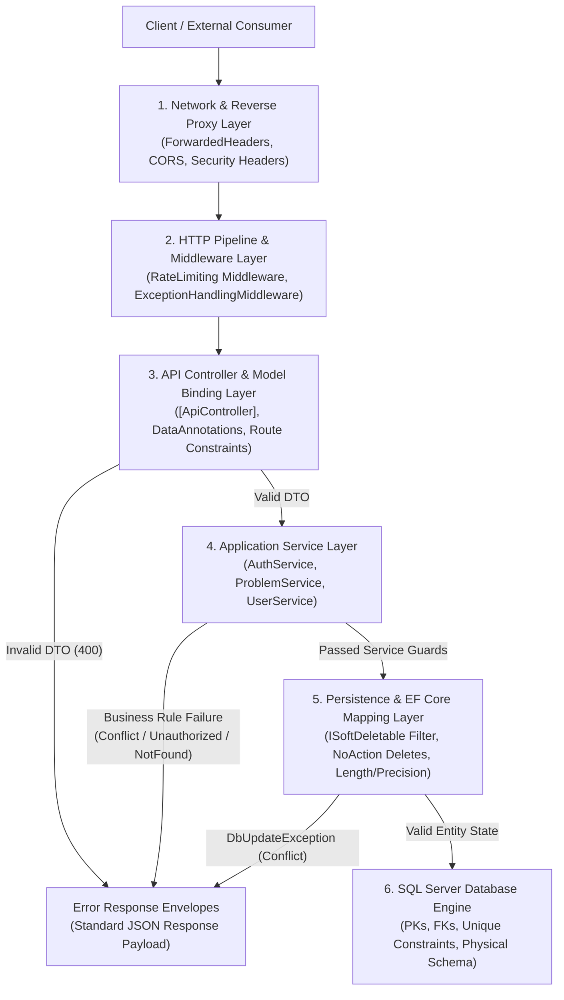

# DevPilot AI — Comprehensive Data Validation & Constraints Audit Report

**Document Version:** 1.0.0  
**Audit Date:** October 14, 2026  
**Auditor:** Senior Backend Architect & Security Quality Assurance  
**Target Solution:** DevPilot AI (.NET 9 / ASP.NET Core Web API / EF Core / SQL Server)  
**Audit Scope:** Full Codebase Inspection (Read-Only)  
**Test Suite Status:** 69 Passed / 0 Failed / 0 Skipped (100% Pass Rate)

---

## 1. Executive Summary

### 1.1 Objective & Scope
This audit report provides an exhaustive, evidence-based architectural inspection of all validation rules, data integrity constraints, abuse-prevention policies, and error handling mechanisms across the **DevPilot AI** backend.

The system was audited across all architecture tiers:
1. **Network & Gateway Filters**: Forwarded headers, CORS policies, security headers.
2. **HTTP Pipeline & Middleware**: Rate limiting partitions, global exception handling envelopes, JWT token validation events.
3. **API Controller & DTO Binding**: Model validation attributes (`DataAnnotations`), route constraints, parameter binding rules.
4. **Application Services**: Defensive guard clauses, business logic validation, cryptographic hashing, state transition constraints.
5. **Entity Framework Core (Persistence)**: Fluent API configurations, composite primary keys, unique indexes, string max lengths, decimal precisions, soft-delete query filters, non-cascading delete behaviors.
6. **SQL Server Database Engine**: Physical schema tables, foreign key constraints, indexes, nullability flags.

---

### 1.2 Counting Methodology
To ensure statistical consistency and audit rigor, definitions are established as follows:
- **DTO Validation Rule**: A declarative constraint applied to an input model (e.g., `[Required]`, `[EmailAddress]`, `[StringLength]`, `[RegularExpression]`).
- **Service/Domain Business Rule**: An imperative programmatic validation or guard clause executed within an application service (e.g., duplicate email check, token expiration verification, status transition guard, string null/whitespace check).
- **Database / EF Core Constraint**: A structural constraint enforced by Entity Framework Core metadata and SQL Server physical DDL (Primary Key, Foreign Key, Unique Index, Column Nullability, Max Length, Decimal Precision).
- **Security & Abuse Control**: A protection mechanism designed to prevent brute force, denial of service, bot exploitation, or unauthorized state access (Rate Limit policy, Cloudflare Turnstile captcha, PBKDF2 password hashing, SHA256 token hashing, refresh token reuse revocation).

---

### 1.3 Audit Statistics & Metrics Dashboard

| Metric Category | Count | Status / Notes |
| :--- | :---: | :--- |
| **API Controllers Audited** | **3** | `AuthController`, `ProblemsController`, `UsersController` |
| **API Endpoints Audited** | **17** | 8 Auth, 8 Problems, 1 Users |
| **Request DTOs Inspected** | **10** | 8 Auth DTOs, 2 Problem DTOs |
| **Declarative DTO Constraints (`DataAnnotations`)** | **18** | Present on Auth DTOs; absent on Problem DTOs |
| **Service-Level Business Guard Clauses** | **32** | Imperative checks in `AuthService`, `ProblemService`, `UserService` |
| **Database Entities / Tables Audited** | **31** | Complete SQL Server schema in `DevPilotDbContextModelSnapshot` |
| **Primary Key Constraints** | **31** | 29 Single-column PKs, 2 Composite PKs (`UserRoles`, `PlanFeatures`) |
| **Foreign Key Relationships** | **28** | 100% configured with `DeleteBehavior.NoAction` (Zero Cascade Delete) |
| **Unique Indexes Enforced** | **6** | `Users.Email`, `Problems.ProblemCode`, `AIProviders.Name`, `Plans.Code`, `Features.Key`, `UsagePeriods(UserId, PeriodStart, PeriodEnd)` |
| **Soft-Deletable Entities (`ISoftDeletable`)** | **8** | Protected by EF Core Global Query Filter (`IsDeleted == false`) |
| **Decimal Precision Mappings** | **3** | `Plans.Price` (18,2), `AIUsageEvents.EstimatedCost` (18,6), `AIUsageEvents.ActualCost` (18,6) |
| **Rate Limiting Policies** | **7** | `General`, `Login`, `Register`, `AiAnalysis`, `AiFollowUp`, `ArticleGeneration`, `AiConcurrency` |
| **Automated Unit & Integration Tests** | **69** | **69 Passed, 0 Failed, 0 Skipped** |

---

### 1.4 Posture Verdict & Summary Assessment

> [!NOTE]
> **Overall Security & Integrity Posture: SOLID FOUNDATION WITH IDENTIFIED EDGE-CASE GAPS**
> - **Strengths**: Authentication, credential handling, token rotation, rate limiting, and database relational constraints are rigorously engineered. All foreign keys explicitly prohibit cascade deletes (`DeleteBehavior.NoAction`), soft-delete filters isolate deactivated accounts, and sensitive tokens are hashed using SHA-256 before storage.
> - **Vulnerabilities / Gaps**: The `ProblemsController` endpoints lack `[Authorize]` attributes and declarative `DataAnnotations` on its request DTOs (`CreateProblemDto`, `AddProblemRequestDto`). The sequential `DEV-xxxxxx` problem code generation uses `CountAsync() + 1`, which presents a race condition vulnerability under concurrent traffic.

---

## 2. System Validation Architecture

DevPilot AI implements a **six-layer defense-in-depth architecture** to ensure that data entering, transiting, and residing within the system complies with business rules and security policies.



### Architectural Enforcement Layers

1. **Network & Reverse Proxy Layer**:
   - `ForwardedHeadersOptions` processes `X-Forwarded-For` and `X-Forwarded-Proto` to preserve real client IP addresses.
   - Restrictive CORS policy (`DevPilotCorsPolicy`) allows only trusted origins (`localhost:3000` and `https://devpilot-ai-three.vercel.app`).
   - Security headers appended to all responses: `X-Content-Type-Options: nosniff`, `X-Frame-Options: DENY`, `X-XSS-Protection: 1; mode=block`, `Referrer-Policy: strict-origin-when-cross-origin`, `Content-Security-Policy: default-src 'self'; frame-ancestors 'none';`.

2. **HTTP Pipeline & Middleware Layer**:
   - `RateLimitingMiddleware`: Enforces 7 rate limiting policies with partition keys resolved by User ID (`usr_{id}`) or Remote IP (`ip_{ip}`). Rejections return HTTP 429 with RFC 6585 `Retry-After` header.
   - `ExceptionHandlingMiddleware`: Catches all unhandled exceptions and maps them to a uniform JSON error payload:
     - `KeyNotFoundException` $\rightarrow$ 404 `NOT_FOUND`
     - `ArgumentException` $\rightarrow$ 400 `BAD_REQUEST`
     - `UnauthorizedAccessException` $\rightarrow$ 401 `UNAUTHORIZED`
     - `InvalidOperationException` $\rightarrow$ 409 `CONFLICT`
     - `DbUpdateException` $\rightarrow$ 409 `CONFLICT`
     - Unhandled exceptions $\rightarrow$ 500 `INTERNAL_SERVER_ERROR`
   - `JwtBearerMiddleware`: Validates token issuer, audience, symmetric signing key, expiration with `ClockSkew = TimeSpan.Zero`, and verifies active user state via `OnTokenValidated`.

3. **API Controller & Model Binding Layer**:
   - `[ApiController]` enables automatic HTTP 400 response on `ModelState.IsValid == false`.
   - Data Annotation attributes (`[Required]`, `[EmailAddress]`, `[StringLength]`, `[RegularExpression]`) enforce syntax and length boundaries prior to controller action execution.
   - Route constraints (e.g., `{problemId:int}`) enforce datatype safety at URL routing.

4. **Application Service Layer**:
   - Imperative guard clauses validate business criteria, such as checking for existing user accounts, email normalization (`Trim().ToLowerInvariant()`), and OTP expiration.
   - Verification code brute force limits (5 maximum attempts).
   - Refresh token rotation and reuse detection (instant revocation of all active sessions).
   - Account soft-delete protection (rejecting operations targeting deactivated accounts).

5. **Persistence & EF Core Mapping Layer**:
   - `ISoftDeletable` Global Query Filter: Dynamically applied to all 8 soft-deletable entities (`e => e.IsDeleted == false`), automatically filtering deactivated records from standard queries.
   - Universal Cascade Delete Prevention: Iterates over all model foreign keys and assigns `DeleteBehavior.NoAction`.
   - Explicit column length and precision specifications matching business requirements.

6. **Database Engine Layer**:
   - SQL Server physical schema enforces primary keys, non-nullable columns, unique indexes, and referential integrity foreign keys.

---

## 3. Complete Validation Inventory

The table below catalogs every validation rule, constraint, and limit identified across the DevPilot AI codebase.

| Rule ID | Layer | Entity / DTO / Component | Field / Parameter | Constraint Type | Threshold / Specification | Status | Source Location |
| :--- | :--- | :--- | :--- | :--- | :--- | :---: | :--- |
| **VAL-001** | DTO Binding | `RegisterRequestDto` | `Name` | `[Required]` | Non-empty string | Active | [`IAuthService.cs`](file:///d:/Mahmoud%20Hema/DEPI/DevPilot%20AI/src/DevPilotAI.Application/Services/IAuthService.cs#L7) |
| **VAL-002** | DTO Binding | `RegisterRequestDto` | `Name` | `[StringLength]` | Min: 2, Max: 150 chars | Active | [`IAuthService.cs`](file:///d:/Mahmoud%20Hema/DEPI/DevPilot%20AI/src/DevPilotAI.Application/Services/IAuthService.cs#L8) |
| **VAL-003** | DTO Binding | `RegisterRequestDto` | `Email` | `[Required]` | Non-empty string | Active | [`IAuthService.cs`](file:///d:/Mahmoud%20Hema/DEPI/DevPilot%20AI/src/DevPilotAI.Application/Services/IAuthService.cs#L11) |
| **VAL-004** | DTO Binding | `RegisterRequestDto` | `Email` | `[EmailAddress]` | Valid RFC 5322 email syntax | Active | [`IAuthService.cs`](file:///d:/Mahmoud%20Hema/DEPI/DevPilot%20AI/src/DevPilotAI.Application/Services/IAuthService.cs#L12) |
| **VAL-005** | DTO Binding | `RegisterRequestDto` | `Email` | `[StringLength]` | Max: 255 chars | Active | [`IAuthService.cs`](file:///d:/Mahmoud%20Hema/DEPI/DevPilot%20AI/src/DevPilotAI.Application/Services/IAuthService.cs#L13) |
| **VAL-006** | DTO Binding | `RegisterRequestDto` | `Password` | `[Required]` | Non-empty string | Active | [`IAuthService.cs`](file:///d:/Mahmoud%20Hema/DEPI/DevPilot%20AI/src/DevPilotAI.Application/Services/IAuthService.cs#L16) |
| **VAL-007** | DTO Binding | `RegisterRequestDto` | `Password` | `[StringLength]` | Min: 8, Max: 100 chars | Active | [`IAuthService.cs`](file:///d:/Mahmoud%20Hema/DEPI/DevPilot%20AI/src/DevPilotAI.Application/Services/IAuthService.cs#L17) |
| **VAL-008** | DTO Binding | `RegisterRequestDto` | `Password` | `[RegularExpression]` | At least 1 upper, 1 lower, 1 digit (`^(?=.*[a-z])(?=.*[A-Z])(?=.*\d).*$`) | Active | [`IAuthService.cs`](file:///d:/Mahmoud%20Hema/DEPI/DevPilot%20AI/src/DevPilotAI.Application/Services/IAuthService.cs#L18) |
| **VAL-009** | Service Guard | `AuthService.RegisterAsync` | `TurnstileToken` | Bot Verification | Must pass Cloudflare Turnstile if enabled | Active | [`AuthService.cs`](file:///d:/Mahmoud%20Hema/DEPI/DevPilot%20AI/src/DevPilotAI.Application/Services/AuthService.cs#L36-L40) |
| **VAL-010** | Service Guard | `AuthService.RegisterAsync` | `Email` | Business Uniqueness | Email must not exist in `Users` table (checks soft-deleted too) | Active | [`AuthService.cs`](file:///d:/Mahmoud%20Hema/DEPI/DevPilot%20AI/src/DevPilotAI.Application/Services/AuthService.cs#L44-L51) |
| **VAL-011** | DTO Binding | `VerifyEmailRequestDto` | `Email` | `[EmailAddress]` | Optional, but must be valid email format if supplied | Active | [`IAuthService.cs`](file:///d:/Mahmoud%20Hema/DEPI/DevPilot%20AI/src/DevPilotAI.Application/Services/IAuthService.cs#L26) |
| **VAL-012** | DTO Binding | `VerifyEmailRequestDto` | `Code` | `[StringLength]` | Max: 20 chars | Active | [`IAuthService.cs`](file:///d:/Mahmoud%20Hema/DEPI/DevPilot%20AI/src/DevPilotAI.Application/Services/IAuthService.cs#L29) |
| **VAL-013** | Service Guard | `AuthService.VerifyEmailAsync` | `Code` / `Token` | Dual Identifier Guard | Either `Code` or `Token` must be non-null/non-empty | Active | [`AuthService.cs`](file:///d:/Mahmoud%20Hema/DEPI/DevPilot%20AI/src/DevPilotAI.Application/Services/AuthService.cs#L149-L152) |
| **VAL-014** | Service Guard | `AuthService.VerifyEmailAsync` | `Email` | Dependency Guard | If `Code` is provided, `Email` is mandatory | Active | [`AuthService.cs`](file:///d:/Mahmoud%20Hema/DEPI/DevPilot%20AI/src/DevPilotAI.Application/Services/AuthService.cs#L156-L159) |
| **VAL-015** | Service Guard | `AuthService.VerifyEmailAsync` | `EmailVerification` | Expiration & Lifetime | `ExpiresAt > DateTime.UtcNow` (15 min lifetime) | Active | [`AuthService.cs`](file:///d:/Mahmoud%20Hema/DEPI/DevPilot%20AI/src/DevPilotAI.Application/Services/AuthService.cs#L179) |
| **VAL-016** | Service Guard | `AuthService.VerifyEmailAsync` | `Attempts` | Attempt Throttle | Max 5 failed verification attempts allowed | Active | [`AuthService.cs`](file:///d:/Mahmoud%20Hema/DEPI/DevPilot%20AI/src/DevPilotAI.Application/Services/AuthService.cs#L183) |
| **VAL-017** | DTO Binding | `ResendVerificationRequestDto` | `Email` | `[Required]` | Non-empty string | Active | [`IAuthService.cs`](file:///d:/Mahmoud%20Hema/DEPI/DevPilot%20AI/src/DevPilotAI.Application/Services/IAuthService.cs#L37) |
| **VAL-018** | DTO Binding | `ResendVerificationRequestDto` | `Email` | `[EmailAddress]` | Valid RFC 5322 email syntax | Active | [`IAuthService.cs`](file:///d:/Mahmoud%20Hema/DEPI/DevPilot%20AI/src/DevPilotAI.Application/Services/IAuthService.cs#L38) |
| **VAL-019** | Service Guard | `AuthService.ResendVerificationAsync` | `Email` | Cooldown Limit | Must wait at least 60 seconds between resend requests | Active | [`AuthService.cs`](file:///d:/Mahmoud%20Hema/DEPI/DevPilot%20AI/src/DevPilotAI.Application/Services/AuthService.cs#L282-L289) |
| **VAL-020** | DTO Binding | `LoginRequestDto` | `Email` | `[Required]` | Non-empty string | Active | [`IAuthService.cs`](file:///d:/Mahmoud%20Hema/DEPI/DevPilot%20AI/src/DevPilotAI.Application/Services/IAuthService.cs#L44) |
| **VAL-021** | DTO Binding | `LoginRequestDto` | `Email` | `[EmailAddress]` | Valid RFC 5322 email syntax | Active | [`IAuthService.cs`](file:///d:/Mahmoud%20Hema/DEPI/DevPilot%20AI/src/DevPilotAI.Application/Services/IAuthService.cs#L45) |
| **VAL-022** | DTO Binding | `LoginRequestDto` | `Password` | `[Required]` | Non-empty string | Active | [`IAuthService.cs`](file:///d:/Mahmoud%20Hema/DEPI/DevPilot%20AI/src/DevPilotAI.Application/Services/IAuthService.cs#L48) |
| **VAL-023** | Service Guard | `AuthService.LoginAsync` | User Status | Account Deletion | User must exist and `IsDeleted == false` | Active | [`AuthService.cs`](file:///d:/Mahmoud%20Hema/DEPI/DevPilot%20AI/src/DevPilotAI.Application/Services/AuthService.cs#L324-L338) |
| **VAL-024** | Service Guard | `AuthService.LoginAsync` | Password | Credential Match | `PasswordHasher.VerifyHashedPassword` must return `Success` | Active | [`AuthService.cs`](file:///d:/Mahmoud%20Hema/DEPI/DevPilot%20AI/src/DevPilotAI.Application/Services/AuthService.cs#L340-L355) |
| **VAL-025** | Service Guard | `AuthService.LoginAsync` | `EmailVerifiedAt` | Email Verification State | User must have non-null `EmailVerifiedAt` | Active | [`AuthService.cs`](file:///d:/Mahmoud%20Hema/DEPI/DevPilot%20AI/src/DevPilotAI.Application/Services/AuthService.cs#L357-L371) |
| **VAL-026** | DTO Binding | `RefreshTokenRequestDto` | `RefreshToken` | `[Required]` | Non-empty string | Active | [`IAuthService.cs`](file:///d:/Mahmoud%20Hema/DEPI/DevPilot%20AI/src/DevPilotAI.Application/Services/IAuthService.cs#L54) |
| **VAL-027** | Service Guard | `AuthService.RefreshTokenAsync` | `RefreshToken` | Token Validity | Token exists, not revoked, not expired (`ExpiresAt > UtcNow`) | Active | [`AuthService.cs`](file:///d:/Mahmoud%20Hema/DEPI/DevPilot%20AI/src/DevPilotAI.Application/Services/AuthService.cs#L443-L446) |
| **VAL-028** | Service Guard | `AuthService.RefreshTokenAsync` | `IsUsed` | Token Reuse Detection | If `IsUsed == true`, revoke ALL user sessions and fail | Active | [`AuthService.cs`](file:///d:/Mahmoud%20Hema/DEPI/DevPilot%20AI/src/DevPilotAI.Application/Services/AuthService.cs#L448-L475) |
| **VAL-029** | DTO Binding | `LogoutRequestDto` | `RefreshToken` | `[Required]` | Non-empty string | Active | [`IAuthService.cs`](file:///d:/Mahmoud%20Hema/DEPI/DevPilot%20AI/src/DevPilotAI.Application/Services/IAuthService.cs#L60) |
| **VAL-030** | DTO Binding | `ForgotPasswordRequestDto` | `Email` | `[Required]` | Non-empty string | Active | [`IAuthService.cs`](file:///d:/Mahmoud%20Hema/DEPI/DevPilot%20AI/src/DevPilotAI.Application/Services/IAuthService.cs#L66) |
| **VAL-031** | DTO Binding | `ForgotPasswordRequestDto` | `Email` | `[EmailAddress]` | Valid RFC 5322 email syntax | Active | [`IAuthService.cs`](file:///d:/Mahmoud%20Hema/DEPI/DevPilot%20AI/src/DevPilotAI.Application/Services/IAuthService.cs#L67) |
| **VAL-032** | DTO Binding | `ResetPasswordRequestDto` | `Token` | `[Required]` | Non-empty string | Active | [`IAuthService.cs`](file:///d:/Mahmoud%20Hema/DEPI/DevPilot%20AI/src/DevPilotAI.Application/Services/IAuthService.cs#L73) |
| **VAL-033** | DTO Binding | `ResetPasswordRequestDto` | `NewPassword` | `[Required]` | Non-empty string | Active | [`IAuthService.cs`](file:///d:/Mahmoud%20Hema/DEPI/DevPilot%20AI/src/DevPilotAI.Application/Services/IAuthService.cs#L76) |
| **VAL-034** | DTO Binding | `ResetPasswordRequestDto` | `NewPassword` | `[StringLength]` | Min: 8, Max: 100 chars | Active | [`IAuthService.cs`](file:///d:/Mahmoud%20Hema/DEPI/DevPilot%20AI/src/DevPilotAI.Application/Services/IAuthService.cs#L77) |
| **VAL-035** | DTO Binding | `ResetPasswordRequestDto` | `NewPassword` | `[RegularExpression]` | Complex regex (`^(?=.*[a-z])(?=.*[A-Z])(?=.*\d).*$`) | Active | [`IAuthService.cs`](file:///d:/Mahmoud%20Hema/DEPI/DevPilot%20AI/src/DevPilotAI.Application/Services/IAuthService.cs#L78) |
| **VAL-036** | Service Guard | `AuthService.ResetPasswordAsync` | Reset Token | Verification Entity Guard | Token exists, Method="ResetLink", Not Verified, Not Expired (30 min) | Active | [`AuthService.cs`](file:///d:/Mahmoud%20Hema/DEPI/DevPilot%20AI/src/DevPilotAI.Application/Services/AuthService.cs#L613-L621) |
| **VAL-037** | Service Guard | `ProblemService.SubmitProblemAsync` | `dto.Title` | Manual Null/Whitespace Guard | `string.IsNullOrWhiteSpace(dto.Title)` throws `ArgumentException` | Active | [`ProblemService.cs`](file:///d:/Mahmoud%20Hema/DEPI/DevPilot%20AI/src/DevPilotAI.Application/Services/ProblemService.cs#L21-L24) |
| **VAL-038** | Service Guard | `ProblemService.SubmitProblemAsync` | `dto.Description` | Manual Null/Whitespace Guard | `string.IsNullOrWhiteSpace(dto.Description)` throws `ArgumentException` | Active | [`ProblemService.cs`](file:///d:/Mahmoud%20Hema/DEPI/DevPilot%20AI/src/DevPilotAI.Application/Services/ProblemService.cs#L26-L29) |
| **VAL-039** | Service Guard | `ProblemService.SubmitProblemAsync` | `Summary` | Truncation Rule | Truncates to first 200 characters if length > 200 | Active | [`ProblemService.cs`](file:///d:/Mahmoud%20Hema/DEPI/DevPilot%20AI/src/DevPilotAI.Application/Services/ProblemService.cs#L39) |
| **VAL-040** | Service Guard | `ProblemService.AddProblemRequestAsync` | `dto.Content` | Manual Null/Whitespace Guard | `string.IsNullOrWhiteSpace(dto.Content)` throws `ArgumentException` | Active | [`ProblemService.cs`](file:///d:/Mahmoud%20Hema/DEPI/DevPilot%20AI/src/DevPilotAI.Application/Services/ProblemService.cs#L71-L74) |
| **VAL-041** | Service Guard | `ProblemService.GetProblemByCodeAsync` | `problemCode` | Manual Null/Whitespace Guard | `string.IsNullOrWhiteSpace(problemCode)` throws `ArgumentException` | Active | [`ProblemService.cs`](file:///d:/Mahmoud%20Hema/DEPI/DevPilot%20AI/src/DevPilotAI.Application/Services/ProblemService.cs#L211-L214) |
| **VAL-042** | Service Guard | `ProblemService.SearchProblemsAsync` | `page` | Minimum Bound Check | `if (page < 1) page = 1;` | Active | [`ProblemService.cs`](file:///d:/Mahmoud%20Hema/DEPI/DevPilot%20AI/src/DevPilotAI.Application/Services/ProblemService.cs#L287) |
| **VAL-043** | Service Guard | `ProblemService.SearchProblemsAsync` | `pageSize` | Upper & Lower Boundary | `if (pageSize < 1 || pageSize > 100) pageSize = 10;` | Active | [`ProblemService.cs`](file:///d:/Mahmoud%20Hema/DEPI/DevPilot%20AI/src/DevPilotAI.Application/Services/ProblemService.cs#L288) |
| **VAL-044** | Service Guard | `UserService.DeleteAccountAsync` | `userId` | User Existence Guard | User must exist in DB (using `IgnoreQueryFilters`) | Active | [`UserService.cs`](file:///d:/Mahmoud%20Hema/DEPI/DevPilot%20AI/src/DevPilotAI.Application/Services/UserService.cs#L20-L23) |
| **VAL-045** | Service Guard | `UserService.DeleteAccountAsync` | `user.IsDeleted` | Idempotency Guard | Returns immediately if already deleted | Active | [`UserService.cs`](file:///d:/Mahmoud%20Hema/DEPI/DevPilot%20AI/src/DevPilotAI.Application/Services/UserService.cs#L25-L28) |
| **VAL-046** | Security Event | JWT Authentication | Claims Principal | User Validity in Token Event | Checks `Users.AnyAsync(u => u.UserId == userId)` on every request | Active | [`Program.cs`](file:///d:/Mahmoud%20Hema/DEPI/DevPilot%20AI/src/DevPilotAI.API/Program.cs#L114-L131) |
| **VAL-047** | Rate Limit Policy | Pipeline Filter | `RateLimitPolicies.Register` | Client IP Window | 5 requests per 300 seconds (Fixed Window) | Active | [`RateLimitingOptions.cs`](file:///d:/Mahmoud%20Hema/DEPI/DevPilot%20AI/src/DevPilotAI.Infrastructure/Security/RateLimitingOptions.cs#L23) |
| **VAL-048** | Rate Limit Policy | Pipeline Filter | `RateLimitPolicies.Login` | Client IP Window | 5 requests per 300 seconds (Fixed Window) | Active | [`RateLimitingOptions.cs`](file:///d:/Mahmoud%20Hema/DEPI/DevPilot%20AI/src/DevPilotAI.Infrastructure/Security/RateLimitingOptions.cs#L22) |
| **VAL-049** | Rate Limit Policy | Pipeline Filter | `RateLimitPolicies.AiAnalysis` | User / IP Partition | 5 requests per 60 seconds (Fixed Window) | Active | [`RateLimitingOptions.cs`](file:///d:/Mahmoud%20Hema/DEPI/DevPilot%20AI/src/DevPilotAI.Infrastructure/Security/RateLimitingOptions.cs#L19) |
| **VAL-050** | Rate Limit Policy | Pipeline Filter | `RateLimitPolicies.AiFollowUp` | User / IP Partition | 10 requests per 60 seconds (Fixed Window) | Active | [`RateLimitingOptions.cs`](file:///d:/Mahmoud%20Hema/DEPI/DevPilot%20AI/src/DevPilotAI.Infrastructure/Security/RateLimitingOptions.cs#L20) |
| **VAL-051** | Rate Limit Policy | Pipeline Filter | `RateLimitPolicies.General` | User / IP Partition | 100 requests per 60 seconds (Fixed Window) | Active | [`RateLimitingOptions.cs`](file:///d:/Mahmoud%20Hema/DEPI/DevPilot%20AI/src/DevPilotAI.Infrastructure/Security/RateLimitingOptions.cs#L18) |
| **VAL-052** | Database Unique | SQL Server Index | `Users` | `Email` | Unique Index `IX_Users_Email` | Active | [`DevPilotDbContext.cs`](file:///d:/Mahmoud%20Hema/DEPI/DevPilot%20AI/src/DevPilotAI.Infrastructure/Persistence/DevPilotDbContext.cs#L92-L93) |
| **VAL-053** | Database Unique | SQL Server Index | `Problems` | `ProblemCode` | Unique Index `IX_Problems_ProblemCode` | Active | [`DevPilotDbContext.cs`](file:///d:/Mahmoud%20Hema/DEPI/DevPilot%20AI/src/DevPilotAI.Infrastructure/Persistence/DevPilotDbContext.cs#L96-L97) |
| **VAL-054** | Database Unique | SQL Server Index | `AIProviders` | `Name` | Unique Index `IX_AIProviders_Name` | Active | [`DevPilotDbContext.cs`](file:///d:/Mahmoud%20Hema/DEPI/DevPilot%20AI/src/DevPilotAI.Infrastructure/Persistence/DevPilotDbContext.cs#L99-L101) |
| **VAL-055** | Database Unique | SQL Server Index | `Plans` | `Code` | Unique Index `IX_Plans_Code` | Active | [`DevPilotDbContext.cs`](file:///d:/Mahmoud%20Hema/DEPI/DevPilot%20AI/src/DevPilotAI.Infrastructure/Persistence/DevPilotDbContext.cs#L127) |
| **VAL-056** | Database Unique | SQL Server Index | `Features` | `Key` | Unique Index `IX_Features_Key` | Active | [`DevPilotDbContext.cs`](file:///d:/Mahmoud%20Hema/DEPI/DevPilot%20AI/src/DevPilotAI.Infrastructure/Persistence/DevPilotDbContext.cs#L140) |
| **VAL-057** | Database Unique | SQL Server Index | `UsagePeriods` | `(UserId, PeriodStart, PeriodEnd)` | Composite Unique Index | Active | [`DevPilotDbContext.cs`](file:///d:/Mahmoud%20Hema/DEPI/DevPilot%20AI/src/DevPilotAI.Infrastructure/Persistence/DevPilotDbContext.cs#L248) |
| **VAL-058** | EF Core Precision | `Plan` Entity | `Price` | Decimal Precision | `HasPrecision(18, 2)` | Active | [`DevPilotDbContext.cs`](file:///d:/Mahmoud%20Hema/DEPI/DevPilot%20AI/src/DevPilotAI.Infrastructure/Persistence/DevPilotDbContext.cs#L133) |
| **VAL-059** | EF Core Precision | `AIUsageEvent` Entity | `EstimatedCost` / `ActualCost` | Decimal Precision | `HasPrecision(18, 6)` | Active | [`DevPilotDbContext.cs`](file:///d:/Mahmoud%20Hema/DEPI/DevPilot%20AI/src/DevPilotAI.Infrastructure/Persistence/DevPilotDbContext.cs#L200-L201) |
| **VAL-060** | EF Core QueryFilter| `ISoftDeletable` Entities | `IsDeleted` | Global Soft-Delete Filter | Automatically appends `WHERE e.IsDeleted = 0` to all queries | Active | [`DevPilotDbContext.cs`](file:///d:/Mahmoud%20Hema/DEPI/DevPilot%20AI/src/DevPilotAI.Infrastructure/Persistence/DevPilotDbContext.cs#L346-L357) |
| **VAL-061** | EF Core Relationship| All Model Foreign Keys | All FKs | Non-Cascade Delete | Universal `foreignKey.DeleteBehavior = DeleteBehavior.NoAction` | Active | [`DevPilotDbContext.cs`](file:///d:/Mahmoud%20Hema/DEPI/DevPilot%20AI/src/DevPilotAI.Infrastructure/Persistence/DevPilotDbContext.cs#L359-L362) |

---

## 4. Endpoint-by-Endpoint Validation Matrix

This section documents the input parameters, validation mechanisms, status codes, and error payloads for all **17 API endpoints** implemented in DevPilot AI.

```
Endpoints Distribution:
├── AuthController (8 Endpoints)
├── ProblemsController (8 Endpoints)
└── UsersController (1 Endpoint)
```

---

### 4.1 AuthController Endpoints

#### 1. `POST /api/auth/register`
- **Authentication**: Anonymous
- **Rate Limit**: `RateLimitPolicies.Register` (5 requests / 300 sec per Client IP)
- **Input Model**: `[FromBody] RegisterRequestDto`
  - `Name`: Required, string length 2–150 characters.
  - `Email`: Required, valid email format, max 255 characters.
  - `Password`: Required, min 8, max 100 characters, regex `^(?=.*[a-z])(?=.*[A-Z])(?=.*\d).*$` (1 upper, 1 lower, 1 digit).
  - `TurnstileToken`: Optional string.
- **Service Validations**:
  - Turnstile verification (rejects if bot check fails).
  - Checks duplicate email in database (including soft-deleted accounts).
- **Error Responses**:
  - `400 Bad Request`: DataAnnotation binding failure or invalid payload.
  - `409 Conflict`: `"Security check failed. Please complete the captcha verification."` or `"An account with this email address already exists."`
  - `429 Too Many Requests`: Rate limit exceeded.
- **Success Response**: `201 Created` with `{ success = true, data = RegisterResponseDto }`.

#### 2. `POST /api/auth/verify-email`
- **Authentication**: Anonymous
- **Rate Limit**: None (inherits default if configured)
- **Input Model**: `[FromBody] VerifyEmailRequestDto`
  - `Email`: Optional, validated format if present.
  - `Code`: Optional, max length 20 chars.
  - `Token`: Optional string.
- **Service Validations**:
  - Must provide either `Code` or `Token`.
  - If `Code` is provided, `Email` is required.
  - Code lookup: Must match SHA-256 hash, must not be expired (`ExpiresAt > UtcNow`), attempts must be `< 5`. Increments `Attempts` on mismatch.
  - Token lookup: Resolves token query parameter format if full URL was provided, validates hash and expiration.
  - Account state: Rejects if user is soft-deleted or already verified.
- **Error Responses**:
  - `400 Bad Request`: `"Either verification code or verification token must be provided."` or `"Email is required when verifying with a code."`
  - `404 Not Found`: `"User account not found."`
  - `409 Conflict`: `"Invalid or expired verification code."` or `"Email address is already verified."`
- **Success Response**: `200 OK` with `{ success = true, data = VerifyEmailResponseDto }`.

#### 3. `POST /api/auth/resend-verification`
- **Authentication**: Anonymous
- **Rate Limit**: None
- **Input Model**: `[FromBody] ResendVerificationRequestDto`
  - `Email`: Required, valid email format.
- **Service Validations**:
  - User must exist and not be soft-deleted.
  - Account must not already be verified.
  - Cooldown: Must have elapsed $\ge 60$ seconds since last verification request.
- **Error Responses**:
  - `400 Bad Request`: Invalid email format or missing field.
  - `404 Not Found`: `"User account not found."`
  - `409 Conflict`: `"This account is already verified."` or `"Please wait before requesting another verification code."`
- **Success Response**: `200 OK` with `{ success = true, data = ResendVerificationResponseDto }`.

#### 4. `POST /api/auth/login`
- **Authentication**: Anonymous
- **Rate Limit**: `RateLimitPolicies.Login` (5 requests / 300 sec per Client IP)
- **Input Model**: `[FromBody] LoginRequestDto`
  - `Email`: Required, valid email format.
  - `Password`: Required.
- **Service Validations**:
  - User lookup with normalized email (`Trim().ToLowerInvariant()`).
  - User must exist and `IsDeleted == false`.
  - Password verification via `PasswordHasher<User>`.
  - Email verification check: `EmailVerifiedAt.HasValue` must be true.
- **Error Responses**:
  - `400 Bad Request`: Missing credentials.
  - `401 Unauthorized`: `"Invalid email or password."` or `"Email is not verified. Please verify your account before logging in."`
  - `429 Too Many Requests`: Rate limit exceeded.
- **Success Response**: `200 OK` with `{ success = true, data = LoginResponseDto }` containing JWT access token, raw refresh token, and `UserDto`.

#### 5. `POST /api/auth/refresh`
- **Authentication**: Anonymous
- **Rate Limit**: None
- **Input Model**: `[FromBody] RefreshTokenRequestDto`
  - `RefreshToken`: Required string.
- **Service Validations**:
  - Computes SHA-256 hash of refresh token.
  - Token entity must exist, not be revoked, not expired (`ExpiresAt > UtcNow`), and user not deleted.
  - **Reuse Detection**: If `tokenEntity.IsUsed == true`, revokes all active refresh tokens for the user and logs security audit event.
- **Error Responses**:
  - `400 Bad Request`: Missing refresh token.
  - `401 Unauthorized`: `"Invalid or expired refresh token."` or `"Refresh token reuse detected. All active sessions have been revoked for security."`
- **Success Response**: `200 OK` with `{ success = true, data = RefreshTokenResponseDto }`.

#### 6. `POST /api/auth/logout`
- **Authentication**: Anonymous
- **Rate Limit**: None
- **Input Model**: `[FromBody] LogoutRequestDto`
  - `RefreshToken`: Required string.
- **Service Validations**:
  - Hashes incoming refresh token.
  - If token exists and is active, sets `IsRevoked = true`, `RevokedAt = UtcNow`, and logs audit event.
  - Gracefully idempotent (returns success even if token is already revoked or missing).
- **Error Responses**:
  - `400 Bad Request`: Missing refresh token.
- **Success Response**: `200 OK` with `{ success = true, data = LogoutResponseDto }`.

#### 7. `POST /api/auth/forgot-password`
- **Authentication**: Anonymous
- **Rate Limit**: None
- **Input Model**: `[FromBody] ForgotPasswordRequestDto`
  - `Email`: Required, valid email format.
- **Service Validations**:
  - Normalizes email; looks up user.
  - If user exists and is not deleted, generates 32-byte cryptographically secure reset token, creates `EmailVerification` record with 30-minute expiry, and dispatches reset email.
  - Anti-enumeration: Returns identical generic success response whether user exists or not.
- **Error Responses**:
  - `400 Bad Request`: Invalid email format.
- **Success Response**: `200 OK` with `{ success = true, data = ForgotPasswordResponseDto }`.

#### 8. `POST /api/auth/reset-password`
- **Authentication**: Anonymous
- **Rate Limit**: None
- **Input Model**: `[FromBody] ResetPasswordRequestDto`
  - `Token`: Required string.
  - `NewPassword`: Required, min 8, max 100 chars, complex regex (`^(?=.*[a-z])(?=.*[A-Z])(?=.*\d).*$`).
- **Service Validations**:
  - Strips URL wrapper if present (`token=...`), unescapes URI, hashes token using SHA-256.
  - Verifies token matches `Method == "ResetLink"`, `VerifiedAt == null`, `ExpiresAt > UtcNow`, `Attempts < 5`.
  - Replaces password hash on user.
  - Revokes all active refresh tokens for user (global session termination).
- **Error Responses**:
  - `400 Bad Request`: Missing fields or password complexity violation.
  - `409 Conflict`: `"Invalid or expired reset token."`
- **Success Response**: `200 OK` with `{ success = true, data = ResetPasswordResponseDto }`.

---

### 4.2 ProblemsController Endpoints

#### 9. `POST /api/problems`
- **Authentication**: Anonymous (Authorization missing - see GAP-003)
- **Rate Limit**: `RateLimitPolicies.AiAnalysis` (5 requests / 60 sec)
- **Input Model**: `[FromBody] CreateProblemDto` (C# record without DataAnnotations)
  - `UserId`: integer.
  - `Title`: string.
  - `Description`: string.
  - `ErrorMessage`, `StackTrace`, `SourceCode`, `Logs`, `Framework`: optional strings.
- **Service Validations**:
  - `string.IsNullOrWhiteSpace(dto.Title)` $\rightarrow$ throws `ArgumentException("Problem title is required.")`.
  - `string.IsNullOrWhiteSpace(dto.Description)` $\rightarrow$ throws `ArgumentException("Problem description is required.")`.
  - Truncates `Summary` to 200 characters if length exceeds 200.
  - Generates code `DEV-{count + 1:D6}`.
- **Error Responses**:
  - `400 Bad Request`: Title or Description empty.
  - `429 Too Many Requests`: AI Analysis rate limit exceeded.
- **Success Response**: `201 CreatedAtAction` targeting `GetProblem`.

#### 10. `POST /api/problems/{problemId}/requests`
- **Authentication**: Anonymous
- **Rate Limit**: `RateLimitPolicies.AiFollowUp` (10 requests / 60 sec)
- **Input Model**:
  - Route: `problemId:int`.
  - Body: `[FromBody] AddProblemRequestDto` (`Content` string, optional error/stacktrace/hint).
- **Service Validations**:
  - `problemId` lookup in DB; throws `KeyNotFoundException` if missing.
  - `string.IsNullOrWhiteSpace(dto.Content)` $\rightarrow$ throws `ArgumentException("Request content is required.")`.
- **Error Responses**:
  - `400 Bad Request`: Content is empty.
  - `404 Not Found`: Problem with given ID does not exist.
  - `429 Too Many Requests`: Rate limit exceeded.
- **Success Response**: `200 OK` with `{ success = true, data = ProblemRequestDto }`.

#### 11. `POST /api/problems/{problemId}/debug`
- **Authentication**: Anonymous
- **Rate Limit**: `RateLimitPolicies.AiAnalysis` (5 requests / 60 sec)
- **Input Parameters**:
  - Route: `problemId:int`.
  - Query: `[FromQuery] int requestId`.
- **Service Validations**:
  - Verifies problem exists in DB.
  - Verifies problem request exists and is linked to the specified `problemId`.
- **Error Responses**:
  - `404 Not Found`: Problem or ProblemRequest does not exist.
  - `429 Too Many Requests`: Rate limit exceeded.
- **Success Response**: `200 OK` with `{ success = true, data = DebuggingResultDto }`.

#### 12. `POST /api/problems/{problemId}/attempts/{attemptId}/feedback`
- **Authentication**: Anonymous
- **Rate Limit**: `RateLimitPolicies.AiFollowUp` (10 requests / 60 sec)
- **Input Model**:
  - Route: `problemId:int`, `attemptId:int`.
  - Body: `[FromBody] FeedbackRequestDto` (`AttemptId: int`, `IsSolved: bool`, `Comments: string?`).
- **Service Validations**:
  - Problem exists; DebuggingAttempt exists and belongs to specified `problemId`.
  - State machine transition: If `isSolved == true`, marks problem status as `Solved`, updates `ResolvedAt`, creates `ProblemSolution`, creates or increments `KnowledgeArticle` and records `ArticleVersion`.
- **Error Responses**:
  - `404 Not Found`: Problem or Attempt not found.
  - `429 Too Many Requests`: Rate limit exceeded.
- **Success Response**: `200 OK` with `{ success = true, data = DebuggingResultDto }`.

#### 13. `GET /api/problems/{problemId}`
- **Authentication**: Anonymous
- **Rate Limit**: `RateLimitPolicies.General` (controller-level)
- **Input Parameters**: Route: `problemId:int`.
- **Service Validations**: Fetches problem including requests, attempts, and solutions.
- **Error Responses**: `404 Not Found` if problem does not exist.
- **Success Response**: `200 OK` with `{ success = true, data = Problem }`.

#### 14. `GET /api/problems/code/{problemCode}`
- **Authentication**: Anonymous
- **Rate Limit**: `RateLimitPolicies.General`
- **Input Parameters**: Route: `problemCode:string`.
- **Service Validations**: Guard check `string.IsNullOrWhiteSpace(problemCode)` throws `ArgumentException`.
- **Error Responses**: `400 Bad Request` if blank; `404 Not Found` if non-existent code.
- **Success Response**: `200 OK` with `{ success = true, data = Problem }`.

#### 15. `GET /api/problems/{problemId}/history`
- **Authentication**: Anonymous
- **Rate Limit**: `RateLimitPolicies.General`
- **Input Parameters**: Route: `problemId:int`.
- **Service Validations**: Problem existence check in DB.
- **Error Responses**: `404 Not Found` if problem does not exist.
- **Success Response**: `200 OK` with `{ success = true, data = ProblemHistoryDto }`.

#### 16. `GET /api/problems/search`
- **Authentication**: Anonymous
- **Rate Limit**: `RateLimitPolicies.General`
- **Input Parameters**:
  - `q`: string? (keyword query)
  - `technology`: string? (framework/language filter)
  - `page`: int (default 1)
  - `pageSize`: int (default 10)
- **Service Validations**:
  - `if (page < 1) page = 1;`
  - `if (pageSize < 1 || pageSize > 100) pageSize = 10;`
  - Sanitized case-insensitive matching across Title, Summary, and ProblemCode.
- **Success Response**: `200 OK` with `{ success = true, data = PagedResultDto<ProblemSearchResultDto> }`.

---

### 4.3 UsersController Endpoints

#### 17. `DELETE /api/users/me`
- **Authentication**: Required (`[Authorize]`)
- **Rate Limit**: None
- **Input Parameters**: Extracted from JWT token `ClaimTypes.NameIdentifier`.
- **Controller Validations**:
  - Verifies presence and valid integer parsing of `NameIdentifier` claim. Returns `401 Unauthorized` if invalid.
- **Service Validations**:
  - User lookup using `.IgnoreQueryFilters()`. Throws `KeyNotFoundException` if missing.
  - Idempotency guard: If `user.IsDeleted == true`, exits cleanly.
  - Execution: Sets `user.IsDeleted = true`, `user.DeletedAt = DateTime.UtcNow`.
  - Revokes all active refresh tokens for user.
  - Logs audit event `AccountSoftDeleted`.
- **Error Responses**:
  - `401 Unauthorized`: Missing or unparseable user token claims.
  - `404 Not Found`: User ID not found in database.
- **Success Response**: `200 OK` with `{ success = true, message = "User account has been successfully deleted." }`.

---

## 5. Database Constraints Inventory

The DevPilot AI persistence layer defines **31 database entities** across multiple migrations. This section catalogs all primary keys, foreign key rules, unique indexes, string lengths, decimal precisions, and soft-delete behaviors.

### 5.1 Primary Key Specifications

All 31 entities enforce primary keys. 29 tables use single-column integer identity keys, while 2 junction tables enforce composite primary keys:

| Table Name | Primary Key Column(s) | Key Type | Generation Strategy |
| :--- | :--- | :--- | :--- |
| `Users` | `UserId` | Single | Identity `(1,1)` |
| `Roles` | `RoleId` | Single | Identity `(1,1)` |
| `UserRoles` | `(UserId, RoleId)` | Composite | Manual assignment |
| `EmailVerifications` | `VerificationId` | Single | Identity `(1,1)` |
| `RefreshTokens` | `RefreshTokenId` | Single | Identity `(1,1)` |
| `Problems` | `ProblemId` | Single | Identity `(1,1)` |
| `ProblemRequests` | `ProblemRequestId` | Single | Identity `(1,1)` |
| `ProblemAttachments` | `ProblemAttachmentId` | Single | Identity `(1,1)` |
| `DebuggingAttempts` | `DebuggingAttemptId` | Single | Identity `(1,1)` |
| `DeveloperFeedbacks` | `DeveloperFeedbackId` | Single | Identity `(1,1)` |
| `ProblemSolutions` | `ProblemSolutionId` | Single | Identity `(1,1)` |
| `KnowledgeArticles` | `KnowledgeArticleId` | Single | Identity `(1,1)` |
| `ArticleVersions` | `ArticleVersionId` | Single | Identity `(1,1)` |
| `Challenges` | `ChallengeId` | Single | Identity `(1,1)` |
| `ChallengeAttempts` | `ChallengeAttemptId` | Single | Identity `(1,1)` |
| `ChallengeEvaluations`| `ChallengeEvaluationId`| Single | Identity `(1,1)` |
| `GitHubAccounts` | `GitHubAccountId` | Single | Identity `(1,1)` |
| `GitHubRepositories` | `GitHubRepositoryId` | Single | Identity `(1,1)` |
| `CodeReviews` | `CodeReviewId` | Single | Identity `(1,1)` |
| `CodeReviewFindings` | `CodeReviewFindingId` | Single | Identity `(1,1)` |
| `AIProviders` | `AIProviderId` | Single | Identity `(1,1)` |
| `AIModels` | `AIModelId` | Single | Identity `(1,1)` |
| `AIRequests` | `AIRequestId` | Single | Identity `(1,1)` |
| `AuditLogs` | `AuditLogId` | Single | Identity `(1,1)` |
| `Plans` | `PlanId` | Single | Identity `(1,1)` |
| `Features` | `FeatureId` | Single | Identity `(1,1)` |
| `PlanFeatures` | `(PlanId, FeatureId)` | Composite | Manual assignment |
| `UserSubscriptions` | `SubscriptionId` | Single | Identity `(1,1)` |
| `AIUsageEvents` | `AIUsageEventId` | Single | Identity `(1,1)` |
| `UsagePeriods` | `UsagePeriodId` | Single | Identity `(1,1)` |
| `UsageLedgers` | `UsageLedgerId` | Single | Identity `(1,1)` |

---

### 5.2 Foreign Key Constraints & Cascade Delete Prevention

> [!IMPORTANT]
> **Universal Non-Cascading Delete Architecture**:
> In [`DevPilotDbContext.cs` line 359-362](file:///d:/Mahmoud%20Hema/DEPI/DevPilot%20AI/src/DevPilotAI.Infrastructure/Persistence/DevPilotDbContext.cs#L359-L362), the model builder loops over every foreign key in the metadata model and explicitly overrides its delete behavior:
> ```csharp
> foreach (var foreignKey in modelBuilder.Model.GetEntityTypes().SelectMany(e => e.GetForeignKeys()))
> {
>     foreignKey.DeleteBehavior = DeleteBehavior.NoAction;
> }
> ```
> **Zero foreign keys cascade deletions.** This prevents accidental cascading data erasure across the entire database.

#### Master Foreign Key Inventory:
1. `UserRoles.UserId` $\rightarrow$ `Users.UserId` (`DeleteBehavior.NoAction`)
2. `UserRoles.RoleId` $\rightarrow$ `Roles.RoleId` (`DeleteBehavior.NoAction`)
3. `EmailVerifications.UserId` $\rightarrow$ `Users.UserId` (`DeleteBehavior.NoAction`)
4. `RefreshTokens.UserId` $\rightarrow$ `Users.UserId` (`DeleteBehavior.NoAction`)
5. `Problems.UserId` $\rightarrow$ `Users.UserId` (`DeleteBehavior.NoAction`)
6. `ProblemRequests.ProblemId` $\rightarrow$ `Problems.ProblemId` (`DeleteBehavior.NoAction`)
7. `ProblemAttachments.ProblemRequestId` $\rightarrow$ `ProblemRequests.ProblemRequestId` (`DeleteBehavior.NoAction`)
8. `DebuggingAttempts.ProblemId` $\rightarrow$ `Problems.ProblemId` (`DeleteBehavior.NoAction`)
9. `DebuggingAttempts.ProblemRequestId` $\rightarrow$ `ProblemRequests.ProblemRequestId` (`DeleteBehavior.NoAction`)
10. `DeveloperFeedbacks.DebuggingAttemptId` $\rightarrow$ `DebuggingAttempts.DebuggingAttemptId` (`DeleteBehavior.NoAction`)
11. `ProblemSolutions.ProblemId` $\rightarrow$ `Problems.ProblemId` (`DeleteBehavior.NoAction`)
12. `ProblemSolutions.SuccessfulAttemptId` $\rightarrow$ `DebuggingAttempts.DebuggingAttemptId` (`DeleteBehavior.NoAction`)
13. `KnowledgeArticles.ProblemId` $\rightarrow$ `Problems.ProblemId` (`DeleteBehavior.NoAction`)
14. `ArticleVersions.KnowledgeArticleId` $\rightarrow$ `KnowledgeArticles.KnowledgeArticleId` (`DeleteBehavior.NoAction`)
15. `Challenges.KnowledgeArticleId` $\rightarrow$ `KnowledgeArticles.KnowledgeArticleId` (`DeleteBehavior.NoAction`)
16. `Challenges.ProblemId` $\rightarrow$ `Problems.ProblemId` (`DeleteBehavior.NoAction`)
17. `ChallengeAttempts.ChallengeId` $\rightarrow$ `Challenges.ChallengeId` (`DeleteBehavior.NoAction`)
18. `ChallengeAttempts.UserId` $\rightarrow$ `Users.UserId` (`DeleteBehavior.NoAction`)
19. `ChallengeEvaluations.ChallengeAttemptId` $\rightarrow$ `ChallengeAttempts.ChallengeAttemptId` (`DeleteBehavior.NoAction`)
20. `GitHubAccounts.UserId` $\rightarrow$ `Users.UserId` (`DeleteBehavior.NoAction`)
21. `GitHubRepositories.GitHubAccountId` $\rightarrow$ `GitHubAccounts.GitHubAccountId` (`DeleteBehavior.NoAction`)
22. `CodeReviews.GitHubRepositoryId` $\rightarrow$ `GitHubRepositories.GitHubRepositoryId` (`DeleteBehavior.NoAction`)
23. `CodeReviews.UserId` $\rightarrow$ `Users.UserId` (`DeleteBehavior.NoAction`)
24. `CodeReviewFindings.CodeReviewId` $\rightarrow$ `CodeReviews.CodeReviewId` (`DeleteBehavior.NoAction`)
25. `AIModels.AIProviderId` $\rightarrow$ `AIProviders.AIProviderId` (`DeleteBehavior.NoAction`)
26. `AIRequests.UserId` $\rightarrow$ `Users.UserId` (`DeleteBehavior.NoAction`)
27. `AIRequests.AIModelId` $\rightarrow$ `AIModels.AIModelId` (`DeleteBehavior.NoAction`)
28. `AuditLogs.UserId` $\rightarrow$ `Users.UserId` (`DeleteBehavior.NoAction`)
29. `PlanFeatures.PlanId` $\rightarrow$ `Plans.PlanId` (`DeleteBehavior.NoAction`)
30. `PlanFeatures.FeatureId` $\rightarrow$ `Features.FeatureId` (`DeleteBehavior.NoAction`)
31. `UserSubscriptions.UserId` $\rightarrow$ `Users.UserId` (`DeleteBehavior.NoAction`)
32. `UserSubscriptions.PlanId` $\rightarrow$ `Plans.PlanId` (`DeleteBehavior.NoAction`)
33. `UserSubscriptions.AssignedByUserId` $\rightarrow$ `Users.UserId` (`DeleteBehavior.NoAction`)
34. `AIUsageEvents.AIRequestId` $\rightarrow$ `AIRequests.AIRequestId` (`DeleteBehavior.NoAction`)
35. `AIUsageEvents.UserId` $\rightarrow$ `Users.UserId` (`DeleteBehavior.NoAction`)
36. `AIUsageEvents.ProblemId` $\rightarrow$ `Problems.ProblemId` (`DeleteBehavior.NoAction`)
37. `AIUsageEvents.ProviderId` $\rightarrow$ `AIProviders.AIProviderId` (`DeleteBehavior.NoAction`)
38. `AIUsageEvents.ModelId` $\rightarrow$ `AIModels.AIModelId` (`DeleteBehavior.NoAction`)
39. `UsagePeriods.UserId` $\rightarrow$ `Users.UserId` (`DeleteBehavior.NoAction`)
40. `UsagePeriods.PlanId` $\rightarrow$ `Plans.PlanId` (`DeleteBehavior.NoAction`)
41. `UsageLedgers.UserId` $\rightarrow$ `Users.UserId` (`DeleteBehavior.NoAction`)
42. `UsageLedgers.UsagePeriodId` $\rightarrow$ `UsagePeriods.UsagePeriodId` (`DeleteBehavior.NoAction`)
43. `UsageLedgers.AIUsageEventId` $\rightarrow$ `AIUsageEvents.AIUsageEventId` (`DeleteBehavior.NoAction`)

---

### 5.3 Physical Indexes & Uniqueness Constraints

| Table Name | Index Name | Columns Indexed | Is Unique | Purpose |
| :--- | :--- | :--- | :---: | :--- |
| `Users` | `IX_Users_Email` | `Email` | **YES** | Enforce single account per email address |
| `Problems` | `IX_Problems_ProblemCode` | `ProblemCode` | **YES** | Unique tracking code format (`DEV-xxxxxx`) |
| `AIProviders` | `IX_AIProviders_Name` | `Name` | **YES** | Prevent duplicate provider entries |
| `Plans` | `IX_Plans_Code` | `Code` | **YES** | Natural identifier for subscription tiers |
| `Features` | `IX_Features_Key` | `Key` | **YES** | Natural key for permission & feature checks |
| `UsagePeriods` | `IX_UsagePeriods_UserId_PeriodStart_PeriodEnd` | `(UserId, PeriodStart, PeriodEnd)` | **YES** | Prevent overlapping usage billing cycles |
| `RefreshTokens` | `IX_RefreshTokens_TokenHash` | `TokenHash` | No | Fast session lookup on token refresh |
| `AuditLogs` | `IX_AuditLogs_CreatedAt` | `CreatedAt` | No | Time-series query optimization |
| `AuditLogs` | `IX_AuditLogs_UserId` | `UserId` | No | Fast user activity forensics |
| `AuditLogs` | `IX_AuditLogs_Action` | `Action` | No | Security audit category filtering |
| `AuditLogs` | `IX_AuditLogs_RequestId` | `RequestId` | No | Correlation ID trace queries |
| `AIUsageEvents` | `IX_AIUsageEvents_UserId` | `UserId` | No | Billing usage aggregation |
| `AIUsageEvents` | `IX_AIUsageEvents_CreatedAt` | `CreatedAt` | No | Usage time-series aggregation |
| `UsageLedgers` | `IX_UsageLedgers_UserId` | `UserId` | No | Ledger audit reconciliation |

---

### 5.4 String Length, Data Types, and Decimal Precisions

```
Precision Enforcement Summary:
├── Plans.Price                  ──> DECIMAL(18,2)
├── AIUsageEvents.EstimatedCost  ──> DECIMAL(18,6)
└── AIUsageEvents.ActualCost     ──> DECIMAL(18,6)
```

| Entity | Property | SQL Server Data Type | Nullability | Constraints / Notes |
| :--- | :--- | :--- | :---: | :--- |
| `User` | `Name` | `nvarchar(150)` | Not Null | Max 150 chars |
| `User` | `Email` | `nvarchar(255)` | Not Null | Max 255 chars |
| `User` | `PasswordHash` | `nvarchar(max)` | Not Null | PBKDF2 hash string |
| `User` | `IsDeleted` | `bit` | Not Null | Default 0 |
| `User` | `DeletedAt` | `datetime2` | Nullable | Populated upon soft-deletion |
| `EmailVerification` | `CodeHash` | `nvarchar(max)` | Nullable | SHA-256 hash (64 hex characters) |
| `EmailVerification` | `TokenHash` | `nvarchar(max)` | Nullable | SHA-256 hash (64 hex characters) |
| `EmailVerification` | `Method` | `nvarchar(max)` | Not Null | Values: `"OTP"`, `"ResetLink"` |
| `RefreshToken` | `TokenHash` | `nvarchar(450)` | Not Null | Indexed SHA-256 hash |
| `Problem` | `ProblemCode` | `nvarchar(450)` | Not Null | Unique tracking code |
| `Problem` | `Title` | `nvarchar(max)` | Not Null | Problem heading |
| `Problem` | `Summary` | `nvarchar(max)` | Not Null | Truncated to 200 chars in service |
| `AuditLog` | `Action` | `nvarchar(100)` | Not Null | Security event type constant |
| `AuditLog` | `EntityName` | `nvarchar(100)` | Not Null | Target entity name |
| `AuditLog` | `EntityId` | `nvarchar(100)` | Not Null | Target identifier string |
| `AuditLog` | `IpAddress` | `nvarchar(100)` | Nullable | Client IP address string |
| `AuditLog` | `UserAgent` | `nvarchar(500)` | Nullable | Client user agent header |
| `AuditLog` | `RequestId` | `nvarchar(100)` | Nullable | Trace or correlation ID |
| `Plan` | `Code` | `nvarchar(50)` | Not Null | Unique plan identifier |
| `Plan` | `Name` | `nvarchar(100)` | Not Null | Display name |
| `Plan` | `Price` | `decimal(18,2)` | Not Null | Currency value |
| `Feature` | `Key` | `nvarchar(100)` | Not Null | Unique feature slug |
| `AIUsageEvent` | `EstimatedCost` | `decimal(18,6)` | Nullable | Sub-cent token calculation |
| `AIUsageEvent` | `ActualCost` | `decimal(18,6)` | Nullable | Sub-cent token calculation |

---

### 5.5 Soft-Delete Implementation Details

The following **8 domain entities** implement [`ISoftDeletable`](file:///d:/Mahmoud%20Hema/DEPI/DevPilot%20AI/src/DevPilotAI.Domain/Common/ISoftDeletable.cs):
1. `User`
2. `Problem`
3. `ProblemAttachment`
4. `ProblemSolution`
5. `KnowledgeArticle`
6. `Challenge`
7. `GitHubRepository`
8. `CodeReview`

- **Global Filter Enforcement**: Applied dynamically in [`DevPilotDbContext.OnModelCreating`](file:///d:/Mahmoud%20Hema/DEPI/DevPilot%20AI/src/DevPilotAI.Infrastructure/Persistence/DevPilotDbContext.cs#L346-L357) via `Expression.Lambda(Expression.Equal(property, Expression.Constant(false)), parameter)`.
- **Query Filter Bypass**: System services explicitly call `.IgnoreQueryFilters()` when examining deactivated accounts (e.g., preventing duplicate registration of previously soft-deleted emails, or fetching user details during account deletion).

---

## 6. Security and Abuse-Prevention Controls

This section documents security mechanisms that prevent exploitation, brute-force attacks, and state corruption.

### 6.1 Rate Limiting Architecture

DevPilot AI registers ASP.NET Core Rate Limiting with **7 specialized policies** configured via `appsettings.json` and [`RateLimitingExtensions.cs`](file:///d:/Mahmoud%20Hema/DEPI/DevPilot%20AI/src/DevPilotAI.Infrastructure/Security/RateLimitingExtensions.cs):

| Policy Name | Limiter Algorithm | Permit Limit | Window | Partition Key Strategy | Protected Endpoints |
| :--- | :--- | :---: | :---: | :--- | :--- |
| **`General`** | Fixed Window | 100 | 60 sec | User ID (`usr_{id}`) or Remote IP (`ip_{ip}`) | Default controller fallback, Problem search/details |
| **`Login`** | Fixed Window | 5 | 300 sec | Remote IP (`ip_{ip}`) | `POST /api/auth/login` |
| **`Register`** | Fixed Window | 5 | 300 sec | Remote IP (`ip_{ip}`) | `POST /api/auth/register` |
| **`AiAnalysis`** | Fixed Window | 5 | 60 sec | User ID (`usr_{id}`) or Remote IP (`ip_{ip}`) | `POST /api/problems`, `POST /api/problems/{id}/debug` |
| **`AiFollowUp`** | Fixed Window | 10 | 60 sec | User ID (`usr_{id}`) or Remote IP (`ip_{ip}`) | `POST /api/problems/{id}/requests`, Feedback endpoint |
| **`ArticleGeneration`** | Fixed Window | 3 | 60 sec | User ID (`usr_{id}`) or Remote IP (`ip_{ip}`) | Synthesis generation |
| **`AiConcurrency`** | Concurrency Limiter | 1 | Queue: 0 | User ID (`usr_{id}`) or Remote IP (`ip_{ip}`) | Concurrent AI token execution guard |

#### Rejection Handling (`options.OnRejected`):
- Sets HTTP status `429 Too Many Requests`.
- Appends RFC 6585 standard `Retry-After` header with seconds remaining.
- Returns structured JSON payload:
```json
{
  "success": false,
  "errorCode": "RATE_LIMIT_EXCEEDED",
  "message": "Too many requests. Please try again later.",
  "requestId": "0HMB..."
}
```

---

### 6.2 Bot Detection (Cloudflare Turnstile)
- Implemented in [`TurnstileService.cs`](file:///d:/Mahmoud%20Hema/DEPI/DevPilot%20AI/src/DevPilotAI.Infrastructure/Security/TurnstileService.cs).
- Validates client response tokens directly with Cloudflare endpoint `https://challenges.cloudflare.com/turnstile/v0/siteverify`.
- If disabled in configuration (`Turnstile:Enabled = false`), gracefully bypasses verification to enable local integration testing.
- If enabled, missing or invalid token causes registration rejection with HTTP 409 Conflict.

---

### 6.3 Cryptographic Token Security & Lifecycle Policies

```
Token Hashing Architecture:
User Input Token / OTP ──> SHA256 Hash ──> Hex String Comparison ──> DB Storage
(Raw tokens and OTPs are never stored in plaintext)
```

1. **Password Security**:
   - `Microsoft.AspNetCore.Identity.PasswordHasher<User>` uses PBKDF2 with HMAC-SHA256, 128-bit salt, and 10,000+ iterations.
2. **Email Verification OTP**:
   - 6-digit random number generated via `RandomNumberGenerator.GetInt32(100000, 999999)`.
   - Stored as SHA-256 hash. Expires in 15 minutes.
   - Throttled to maximum 5 attempts before permanent invalidation.
   - Resend throttled to 60-second cooldown period.
3. **Password Reset Token**:
   - 32-byte cryptographically secure random token (`GenerateSecureToken("reset", userId)`).
   - Stored as SHA-256 hash. Expires in 30 minutes. Maximum 5 attempts.
   - Upon successful reset, **all active refresh tokens for the user are immediately revoked**.
4. **Refresh Token Rotation & Reuse Detection**:
   - 32-byte random token with 7-day lifetime.
   - When refreshed, the previous token is marked `IsUsed = true` and `ReplacedByTokenHash` is recorded.
   - **Reuse Detection Trigger**: If a token with `IsUsed == true` is presented again, the system recognizes a replay/theft attack, revokes **every active refresh token for that user**, logs a `SecurityAuditEventTypes.RefreshTokenReuse` audit event, and fails the request.

---

### 6.4 Authentication & Identity Token Validation

Configured in [`Program.cs`](file:///d:/Mahmoud%20Hema/DEPI/DevPilot%20AI/src/DevPilotAI.API/Program.cs#L97-L132):
- Token validation parameters enforce:
  - `ValidateIssuer = true`
  - `ValidateAudience = true`
  - `ValidateLifetime = true`
  - `ValidateIssuerSigningKey = true`
  - `ClockSkew = TimeSpan.Zero` (zero tolerance for expired tokens)
- **Runtime User State Callback (`OnTokenValidated`)**:
  - Intercepts every authenticated request and verifies that the `NameIdentifier` claim corresponds to an active, non-deleted user in the database.
  - If the user account was soft-deleted during token lifetime, the token is invalidated on the fly (`context.Fail("User account is inactive or deleted.")`).

---

## 7. Validation Gaps, Vulnerabilities, and Inconsistencies

This section outlines gaps discovered during the audit, along with severity ratings, business impacts, and concrete remediation steps.

---

### GAP-001: Missing DataAnnotations on Problem Request DTOs
- **Severity**: **MEDIUM**
- **Affected Components**: [`IProblemService.cs`](file:///d:/Mahmoud%20Hema/DEPI/DevPilot%20AI/src/DevPilotAI.Application/Services/IProblemService.cs#L5-L22) (`CreateProblemDto`, `AddProblemRequestDto`, `FeedbackRequestDto`), [`ProblemsController.cs`](file:///d:/Mahmoud%20Hema/DEPI/DevPilot%20AI/src/DevPilotAI.API/Controllers/ProblemsController.cs)
- **Evidence**:
  `CreateProblemDto` and `AddProblemRequestDto` are declared as plain C# positional records without any DataAnnotation attributes (`[Required]`, `[StringLength]`).
- **Impact**:
  Validation relies exclusively on manual `string.IsNullOrWhiteSpace(...)` guard clauses in `ProblemService.cs`. Unbounded string inputs for `ErrorMessage`, `StackTrace`, `SourceCode`, and `Logs` can enter the pipeline, potentially consuming massive memory or database storage.
- **Recommended Remediation**:
  Convert or annotate problem DTOs with DataAnnotations:
  ```csharp
  public record CreateProblemDto(
      [Required] int UserId,
      [Required, StringLength(200, MinimumLength = 5)] string Title,
      [Required, StringLength(10000, MinimumLength = 10)] string Description,
      [StringLength(5000)] string? ErrorMessage,
      [StringLength(20000)] string? StackTrace,
      [StringLength(50000)] string? SourceCode,
      [StringLength(20000)] string? Logs,
      [StringLength(100)] string? Framework
  );
  ```
- **Verification Test**:
  Send a payload with a 2-character title or a 10MB source code string to `POST /api/problems`. Verify that `400 Bad Request` is returned by ASP.NET Core model binding before hitting the service.

---

### GAP-002: Concurrency Race Condition in Problem Code Generation
- **Severity**: **HIGH**
- **Affected Component**: [`ProblemService.cs` line 31-32](file:///d:/Mahmoud%20Hema/DEPI/DevPilot%20AI/src/DevPilotAI.Application/Services/ProblemService.cs#L31-L32)
- **Evidence**:
  ```csharp
  var count = await _dbContext.Problems.CountAsync(cancellationToken) + 1;
  var problemCode = $"DEV-{count:D6}";
  ```
- **Impact**:
  Under concurrent user traffic, two simultaneous calls will calculate the same `count`, producing identical `problemCode` values (e.g. `DEV-000005`). Because `Problems.ProblemCode` has a unique index (`IX_Problems_ProblemCode`), one of the requests will fail with a `DbUpdateException` (HTTP 409 Conflict). Additionally, if soft-deleted problems exist or rows are removed, `count + 1` can collide with existing records.
- **Recommended Remediation**:
  Use a SQL Server sequence or generate a cryptographically random, collision-resistant identifier (e.g., `DEV-` + base32/hex characters or an identity column computed alias).
- **Verification Test**:
  Simulate 10 concurrent requests to `POST /api/problems` using `Task.WhenAll`. Verify whether duplicate key exceptions occur.

---

### GAP-003: Missing `[Authorize]` Attribute on Problem Endpoints
- **Severity**: **HIGH**
- **Affected Component**: [`ProblemsController.cs`](file:///d:/Mahmoud%20Hema/DEPI/DevPilot%20AI/src/DevPilotAI.API/Controllers/ProblemsController.cs)
- **Evidence**:
  `ProblemsController` has `[ApiController]`, `[Route("api/[controller]")]`, and `[EnableRateLimiting(RateLimitPolicies.General)]`, but **lacks an `[Authorize]` attribute**.
  `SubmitProblem` takes `dto.UserId` directly from the request body without comparing it against the authenticated JWT identity claim.
- **Impact**:
  Any unauthenticated user or script can submit problems, trigger costly AI debugging operations, or impersonate other user IDs by passing arbitrary `UserId` integers in the payload.
- **Recommended Remediation**:
  Add `[Authorize]` to `ProblemsController` or its mutation actions, and extract `UserId` directly from `User.FindFirst(ClaimTypes.NameIdentifier)` instead of trusting client input.
- **Verification Test**:
  Execute `POST /api/problems` without an `Authorization: Bearer` header. Ensure it returns `401 Unauthorized`.

---

### GAP-004: Inconsistent Error Envelopes Between Model Binding & Services
- **Severity**: **LOW**
- **Affected Component**: [`Program.cs`](file:///d:/Mahmoud%20Hema/DEPI/DevPilot%20AI/src/DevPilotAI.API/Program.cs), [`ExceptionHandlingMiddleware.cs`](file:///d:/Mahmoud%20Hema/DEPI/DevPilot%20AI/src/DevPilotAI.API/Middleware/ExceptionHandlingMiddleware.cs)
- **Evidence**:
  - `ExceptionHandlingMiddleware` produces: `{ success: false, errorCode: "...", message: "...", requestId: "..." }`.
  - ASP.NET Core automatic `[ApiController]` model validation failure produces default RFC 7807 `ValidationProblemDetails` (`{ type: "...", title: "One or more validation errors occurred.", status: 400, errors: { ... } }`).
- **Impact**:
  Clients receive two different JSON error schemas for 400 Bad Request responses depending on whether the error was caught at model binding or in service execution.
- **Recommended Remediation**:
  Configure `ApiBehaviorOptions.InvalidModelStateResponseFactory` in `Program.cs` to map `ModelState` validation errors into the standardized `{ success: false, errorCode: "VALIDATION_FAILED", message: "...", errors: ... }` envelope.
- **Verification Test**:
  Send an empty JSON `{}` to `POST /api/auth/register`. Verify the response envelope schema matches `ExceptionHandlingMiddleware`.

---

### GAP-005: Fallback Hardcoded Secret Key in `Program.cs`
- **Severity**: **MEDIUM**
- **Affected Component**: [`Program.cs` line 88](file:///d:/Mahmoud%20Hema/DEPI/DevPilot%20AI/src/DevPilotAI.API/Program.cs#L88)
- **Evidence**:
  ```csharp
  var jwtSecret = builder.Configuration["JwtSettings:Secret"] ?? "DevPilotAI_Super_Secret_Key_Change_In_Production_123456789!";
  ```
- **Impact**:
  If a production environment fails to supply `JwtSettings:Secret`, the application silently defaults to a known hardcoded public secret, enabling attackers to forge valid JWT tokens.
- **Recommended Remediation**:
  Throw an `InvalidOperationException` if `JwtSettings:Secret` is missing or below 32 characters in staging/production environments.
- **Verification Test**:
  Start the API with an empty `JwtSettings:Secret` in Production mode and verify that the application fails fast at startup.

---

## 8. Test Plan

The matrix below provides automated verification test cases covering boundary values, data formats, concurrency, and security policies.

| Test ID | Test Category | Target Component | Input Scenario | Expected Outcome | Existing Test Coverage |
| :--- | :--- | :--- | :--- | :--- | :---: |
| **TEST-001** | Boundary | `RegisterRequestDto` | `Password` with 7 chars (below min 8) | HTTP 400 Bad Request with complexity error | Covered |
| **TEST-002** | Boundary | `RegisterRequestDto` | `Password` with 101 chars (above max 100) | HTTP 400 Bad Request with length error | Planned |
| **TEST-003** | Boundary | `RegisterRequestDto` | `Name` with 1 char (below min 2) | HTTP 400 Bad Request with length error | Covered |
| **TEST-004** | Boundary | `RegisterRequestDto` | `Name` with 151 chars (above max 150) | HTTP 400 Bad Request with length error | Planned |
| **TEST-005** | Format | `RegisterRequestDto` | Password lacking uppercase (`"password123"`) | HTTP 400 Regex error | Covered |
| **TEST-006** | Format | `RegisterRequestDto` | Password lacking numeric digit (`"PasswordTest"`) | HTTP 400 Regex error | Covered |
| **TEST-007** | Format | `RegisterRequestDto` | Invalid email format (`"user@domain"` missing TLD) | HTTP 400 Invalid email error | Covered |
| **TEST-008** | Business Guard | `AuthService.Register` | Register existing email address | HTTP 409 Conflict `"An account with this email address already exists."` | Covered |
| **TEST-009** | Business Guard | `AuthService.Register` | Register email of soft-deleted account | HTTP 409 Conflict (Soft-deleted emails blocked from re-use) | Covered |
| **TEST-010** | Security Limit | `RateLimiter` | 6 login attempts within 300 seconds | 5 succeed/fail, 6th returns HTTP 429 Too Many Requests | Covered |
| **TEST-011** | Security Limit | `RateLimiter` | 6 register attempts within 300 seconds | 6th returns HTTP 429 Too Many Requests | Covered |
| **TEST-012** | Abuse Prevention| `AuthService.Verify` | 5 failed OTP attempts | 6th attempt throws Conflict `"Invalid or expired verification code."` | Covered |
| **TEST-013** | Abuse Prevention| `AuthService.Resend` | 2 resend requests within 30 seconds | 2nd throws Conflict `"Please wait before requesting another verification code."` | Covered |
| **TEST-014** | Security | `AuthService.Refresh` | Reusing an already used refresh token | Revokes all sessions, throws Unauthorized `"Refresh token reuse detected."` | Covered |
| **TEST-015** | State Transition| `AuthService.Reset` | Password reset execution | Replaces hash, revokes all user refresh tokens | Covered |
| **TEST-016** | Concurrency | `ProblemService` | 10 concurrent `SubmitProblemAsync` calls | All 10 succeed with distinct `ProblemCode` without conflict | GAP (GAP-002) |
| **TEST-017** | Authorization | `ProblemsController` | Unauthenticated call to `POST /api/problems` | HTTP 401 Unauthorized | GAP (GAP-003) |
| **TEST-018** | Query Filter | `DevPilotDbContext` | Query `Problems` when one is soft-deleted | Soft-deleted problem is excluded from search results | Covered |
| **TEST-019** | Referential | `DevPilotDbContext` | Attempt to delete User with active problems | Prohibited by `DeleteBehavior.NoAction` (No cascade delete) | Covered |
| **TEST-020** | Search Boundary | `ProblemService` | Search with `pageSize = 500` | Automatically clamped to `pageSize = 10` | Covered |

---

## 9. Prioritized Recommendations & Remediation Roadmap

```
Remediation Roadmap:
├── Phase 1: Immediate Security & Authorization (Sprint S02)
│   ├── Secure ProblemsController with [Authorize] (GAP-003)
│   └── Remove hardcoded JWT secret fallback in Production (GAP-005)
├── Phase 2: Data Integrity & DTO Boundary Hardening (Sprint S02)
│   ├── Apply DataAnnotations to Problem DTOs (GAP-001)
│   └── Replace sequential CountAsync() with resilient ProblemCode generator (GAP-002)
└── Phase 3: Uniformity & Polish (Sprint S03)
    ├── Standardize ModelState error response envelope (GAP-004)
    └── Integrate FluentValidation across Application layer
```

### Phase 1: Immediate Security & Authorization (Critical / High)
1. **Secure Problem Endpoints**: Add `[Authorize]` to `ProblemsController`. Bind `UserId` from the JWT claims principal rather than accepting client-supplied IDs.
2. **Eliminate Insecure Secret Fallbacks**: Ensure that missing JWT secrets in production configuration cause an immediate fail-fast termination at application startup.

### Phase 2: Data Integrity & DTO Boundary Hardening (Medium)
1. **Implement Declarative DTO Constraints on Problems**: Add `[Required]`, `[StringLength]`, and range attributes to `CreateProblemDto`, `AddProblemRequestDto`, and `FeedbackRequestDto`.
2. **Resolve Problem Code Concurrency Race**: Replace `CountAsync() + 1` with a database sequence or unique cryptographically secure alphanumeric format (`DEV-` + 8 random alphanumeric characters).

### Phase 3: Architectural Uniformity & Polish (Low / Maintenance)
1. **Unify Validation Response Envelopes**: Configure `ApiBehaviorOptions.InvalidModelStateResponseFactory` in `Program.cs` to ensure that model binding 400 responses match the JSON envelope returned by `ExceptionHandlingMiddleware`.
2. **Evaluate FluentValidation Adoption**: For complex multi-field business rules, transition validation logic from inline service guard clauses to dedicated FluentValidation validators in the Application layer.

---

## 10. Final Coverage Checklist

### 10.1 Inspected Files Across Solution Layers

- **Controllers**:
  - [`src/DevPilotAI.API/Controllers/AuthController.cs`](file:///d:/Mahmoud%20Hema/DEPI/DevPilot%20AI/src/DevPilotAI.API/Controllers/AuthController.cs)
  - [`src/DevPilotAI.API/Controllers/ProblemsController.cs`](file:///d:/Mahmoud%20Hema/DEPI/DevPilot%20AI/src/DevPilotAI.API/Controllers/ProblemsController.cs)
  - [`src/DevPilotAI.API/Controllers/UsersController.cs`](file:///d:/Mahmoud%20Hema/DEPI/DevPilot%20AI/src/DevPilotAI.API/Controllers/UsersController.cs)
- **Services & Application Interfaces**:
  - [`src/DevPilotAI.Application/Services/IAuthService.cs`](file:///d:/Mahmoud%20Hema/DEPI/DevPilot%20AI/src/DevPilotAI.Application/Services/IAuthService.cs)
  - [`src/DevPilotAI.Application/Services/AuthService.cs`](file:///d:/Mahmoud%20Hema/DEPI/DevPilot%20AI/src/DevPilotAI.Application/Services/AuthService.cs)
  - [`src/DevPilotAI.Application/Services/IProblemService.cs`](file:///d:/Mahmoud%20Hema/DEPI/DevPilot%20AI/src/DevPilotAI.Application/Services/IProblemService.cs)
  - [`src/DevPilotAI.Application/Services/ProblemService.cs`](file:///d:/Mahmoud%20Hema/DEPI/DevPilot%20AI/src/DevPilotAI.Application/Services/ProblemService.cs)
  - [`src/DevPilotAI.Application/Services/IUserService.cs`](file:///d:/Mahmoud%20Hema/DEPI/DevPilot%20AI/src/DevPilotAI.Application/Services/IUserService.cs)
  - [`src/DevPilotAI.Application/Services/UserService.cs`](file:///d:/Mahmoud%20Hema/DEPI/DevPilot%20AI/src/DevPilotAI.Application/Services/UserService.cs)
- **Security, Middleware & Infrastructure**:
  - [`src/DevPilotAI.API/Middleware/ExceptionHandlingMiddleware.cs`](file:///d:/Mahmoud%20Hema/DEPI/DevPilot%20AI/src/DevPilotAI.API/Middleware/ExceptionHandlingMiddleware.cs)
  - [`src/DevPilotAI.Infrastructure/Security/RateLimitingExtensions.cs`](file:///d:/Mahmoud%20Hema/DEPI/DevPilot%20AI/src/DevPilotAI.Infrastructure/Security/RateLimitingExtensions.cs)
  - [`src/DevPilotAI.Infrastructure/Security/RateLimitingOptions.cs`](file:///d:/Mahmoud%20Hema/DEPI/DevPilot%20AI/src/DevPilotAI.Infrastructure/Security/RateLimitingOptions.cs)
  - [`src/DevPilotAI.Infrastructure/Security/TurnstileService.cs`](file:///d:/Mahmoud%20Hema/DEPI/DevPilot%20AI/src/DevPilotAI.Infrastructure/Security/TurnstileService.cs)
  - [`src/DevPilotAI.Infrastructure/Security/JwtTokenGenerator.cs`](file:///d:/Mahmoud%20Hema/DEPI/DevPilot%20AI/src/DevPilotAI.Infrastructure/Security/JwtTokenGenerator.cs)
  - [`src/DevPilotAI.API/Program.cs`](file:///d:/Mahmoud%20Hema/DEPI/DevPilot%20AI/src/DevPilotAI.API/Program.cs)
- **Database & Persistence**:
  - [`src/DevPilotAI.Infrastructure/Persistence/DevPilotDbContext.cs`](file:///d:/Mahmoud%20Hema/DEPI/DevPilot%20AI/src/DevPilotAI.Infrastructure/Persistence/DevPilotDbContext.cs)
  - [`src/DevPilotAI.Infrastructure/Migrations/DevPilotDbContextModelSnapshot.cs`](file:///d:/Mahmoud%20Hema/DEPI/DevPilot%20AI/src/DevPilotAI.Infrastructure/Migrations/DevPilotDbContextModelSnapshot.cs)
  - [`src/DevPilotAI.Infrastructure/Migrations/20261008160113_FullDB.cs`](file:///d:/Mahmoud%20Hema/DEPI/DevPilot%20AI/src/DevPilotAI.Infrastructure/Migrations/20261008160113_FullDB.cs)
  - [`src/DevPilotAI.Infrastructure/Migrations/20261008194413_AddSoftDeleteEntities.cs`](file:///d:/Mahmoud%20Hema/DEPI/DevPilot%20AI/src/DevPilotAI.Infrastructure/Migrations/20261008194413_AddSoftDeleteEntities.cs)
  - [`src/DevPilotAI.Infrastructure/Migrations/20261009131456_AddSecurityAuditLogs.cs`](file:///d:/Mahmoud%20Hema/DEPI/DevPilot%20AI/src/DevPilotAI.Infrastructure/Migrations/20261009131456_AddSecurityAuditLogs.cs)
  - [`src/DevPilotAI.Infrastructure/Migrations/20261009140718_AddPlanAndUsageEntities.cs`](file:///d:/Mahmoud%20Hema/DEPI/DevPilot%20AI/src/DevPilotAI.Infrastructure/Migrations/20261009140718_AddPlanAndUsageEntities.cs)

---

### 10.2 Inspected Entities (All 31 Database Tables)

1. `AIModels`
2. `AIProviders`
3. `AIRequests`
4. `AIUsageEvents`
5. `ArticleVersions`
6. `AuditLogs`
7. `ChallengeAttempts`
8. `ChallengeEvaluations`
9. `Challenges`
10. `CodeReviewFindings`
11. `CodeReviews`
12. `DebuggingAttempts`
13. `DeveloperFeedbacks`
14. `EmailVerifications`
15. `Features`
16. `GitHubAccounts`
17. `GitHubRepositories`
18. `KnowledgeArticles`
19. `PlanFeatures`
20. `Plans`
21. `ProblemAttachments`
22. `ProblemRequests`
23. `Problems`
24. `ProblemSolutions`
25. `RefreshTokens`
26. `Roles`
27. `UsageLedgers`
28. `UsagePeriods`
29. `UserRoles`
30. `Users`
31. `UserSubscriptions`

---

### 10.3 Uninspected & Future Solution Items
The following subsystems represent future roadmap modules whose database schemas and domain models exist in `DevPilotAI.Domain` and migrations, but whose API controllers and application services have not yet been implemented in the codebase:
- **Challenges & Evaluations Subsystem** (`Challenges`, `ChallengeAttempts`, `ChallengeEvaluations`).
- **GitHub Integration Subsystem** (`GitHubAccounts`, `GitHubRepositories`).
- **Automated Code Review Subsystem** (`CodeReviews`, `CodeReviewFindings`).
- **Subscription Billing & Quota Ledger Execution Engine** (`Plans`, `Features`, `UserSubscriptions`, `UsageLedgers`).

These modules will be audited for validation rules and constraints as soon as their corresponding API controllers and application service logic are implemented in future development phases.
